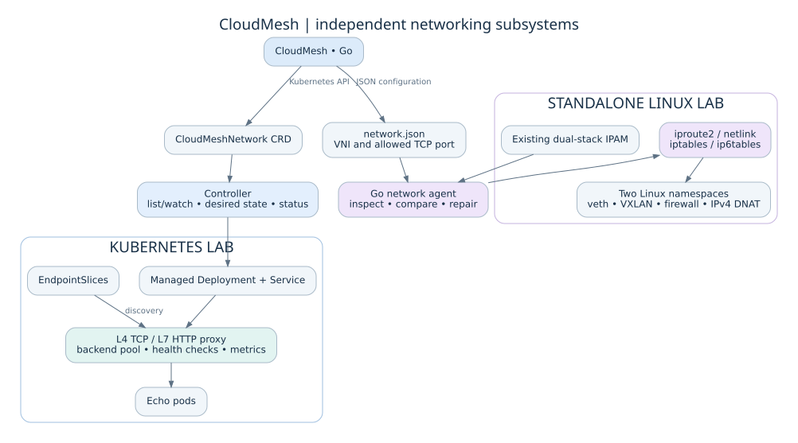
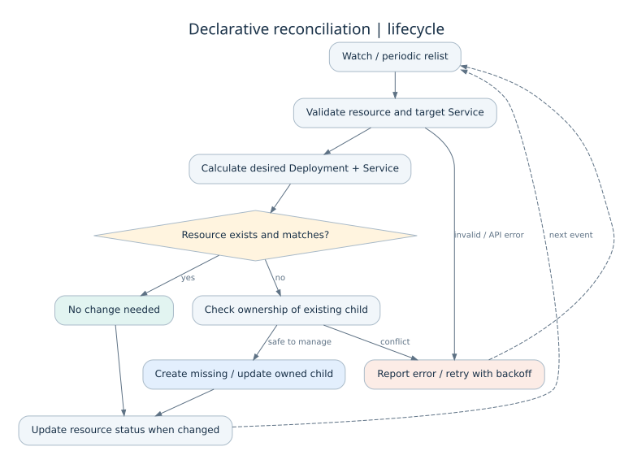
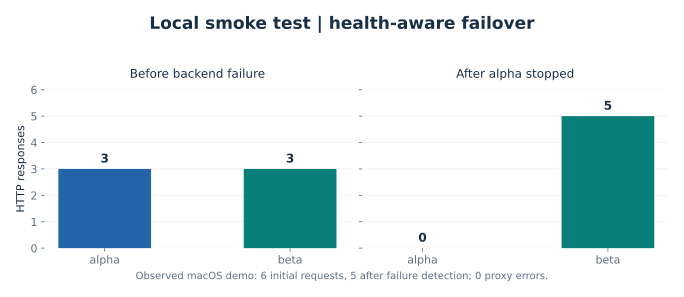
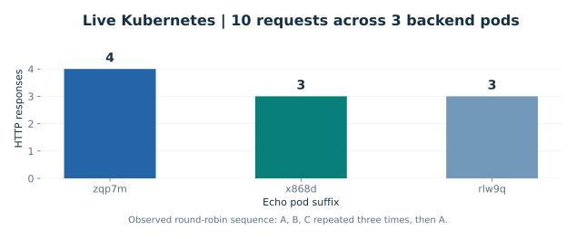
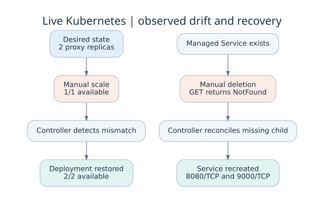
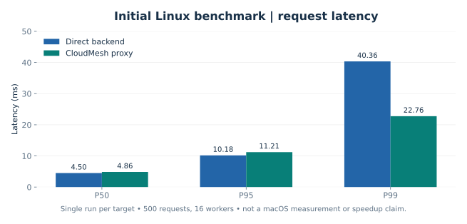

# CloudMesh — Distributed Cloud Networking Platform

CloudMesh is a Kubernetes-aware networking platform written in Go. It combines dynamic service discovery, concurrent Layer 4 (TCP) and Layer 7 (HTTP) forwarding, backend scheduling, health monitoring and declarative network configuration through a custom Kubernetes controller.

I started with a small load-balancing prototype and extended the project to explore how a Kubernetes control plane can manage networking infrastructure automatically. My goal was to understand the software behind cloud networking: how endpoints are discovered, how traffic is distributed, how desired state is reconciled, and how the system recovers when resources change or fail.

The core software and custom controller have been validated on my Apple Silicon Mac using Docker Desktop and a local two-node kind Kubernetes cluster. No paid cloud infrastructure is needed for the demonstrations below.

## Contents

- [What is implemented](#what-is-implemented)
- [Architecture](#architecture)
- [Repository structure](#repository-structure)
- [Getting started](#getting-started)
- [Running the Kubernetes controller](#running-the-kubernetes-controller)
- [Live controller validation](#live-controller-validation)
- [Testing and coverage](#testing-and-coverage)
- [Performance benchmarking](#performance-benchmarking)
- [Detailed results and evidence](docs/results.md)
- [Linux networking lab](#linux-networking-lab)
- [Troubleshooting](#troubleshooting)
- [Limitations and next steps](#limitations-and-next-steps)

## What is implemented

| Component | Implementation | Verification status |
| --- | --- | --- |
| L4 forwarding | Concurrent TCP proxy | Local and live Kubernetes traffic tested |
| L7 forwarding | HTTP reverse proxy | Local and live Kubernetes traffic tested |
| Backend selection | Round robin, least connections, rendezvous hashing | Go tests passed; round-robin distribution demonstrated live |
| Backend health | TCP connectivity probes and exclusion of unhealthy backends | Local failover demonstrated |
| Service discovery | Kubernetes EndpointSlice list/watch and backend state reconciliation | Mock API tests and live Kubernetes requests passed |
| Custom Kubernetes API | `CloudMeshNetwork` CRD, schema and configuration validation | Registered on a live cluster; invalid algorithm rejected |
| Custom controller | Managed Deployment/Service creation, updates, status, ownership and periodic reconciliation | Live rollout, scaling, drift repair and cleanup passed |
| IPv4/IPv6 IPAM | Bounded address allocator with synchronized ownership tracking | Go tests passed |
| Observability | Prometheus-format counters, health and readiness endpoints | Local demo emitted metrics |
| Linux networking lab | Go-generated namespace, veth, VXLAN, firewall and DNAT commands | Command-plan tests passed; privileged execution pending |
| Container deployment | Multi-stage Docker images and Kubernetes manifests | Both application and controller images built and deployed |
| CI | GitHub Actions workflow for Go tests and smoke demo | Workflow supplied; hosted CI status not recorded here |

**Validation snapshot — November 26, 2026 (local time):** six internal Go packages passed race tests, the custom controller reached 80.4% statement coverage, ten HTTP requests were distributed among three Kubernetes backends, and the controller restored the intended replica count after a manual change. These are functional results, not production scalability or availability guarantees.

## Architecture



*Figure 1. Implemented architecture: a separate controller manages proxy resources; the proxy discovers and forwards to backend pods.*

CloudMesh has two distinct software responsibilities:

- **Control plane:** the custom Go controller reads declarative `CloudMeshNetwork` resources from Kubernetes and creates or updates the corresponding proxy Deployment and Service. It also reports resource status.
- **Data plane:** each CloudMesh proxy discovers ready backend IPs from EndpointSlices, keeps its own synchronized backend pool and forwards TCP or HTTP traffic to a selected endpoint.

The proxy and the custom controller run in separate processes. Within each proxy, discovery and forwarding share an in-memory backend pool. Each replica maintains its own scheduling counters and backend health state; replicas do not share global connection counts.

The Linux networking lab is a separate executable for exploring network virtualization. It is not a custom Kubernetes CNI and is not managed by the custom controller in the current version.

### How reconciliation works



*Figure 2. Conceptual reconciliation flow, including no-op updates and retry paths.*

Kubernetes stores the desired configuration in the custom resource's `spec`. The controller lists resources, validates each specification and checks that the referenced Service and named port exist. It calculates the desired Deployment and Service, checks ownership, creates missing resources or updates declared fields when they differ, and reports progress in `status`.

The controller then watches resource generation changes. Its finite 15-second watch also provides periodic relisting, which helps recover missing child resources and repair supported configuration drift. API/watch errors trigger bounded exponential backoff and a fresh list. Status-only events are ignored to avoid unnecessary reconciliation loops.

This implementation intentionally uses the Go standard library and the Kubernetes REST API rather than a separate controller framework. It uses a single reconciliation worker, namespace-scoped permissions and Kubernetes owner references. See [controller design notes](docs/custom-controller.md) for more implementation details.

## Repository structure

```text
cloudmesh/
├── cmd/
│   ├── cloudmesh/             # TCP/HTTP proxy executable
│   ├── controller/            # Custom Kubernetes controller executable
│   ├── echo/                  # Demo backend returning its identity
│   └── netlab/                # Linux networking lab executable
├── internal/
│   ├── controller/
│   │   ├── types.go           # Custom resource types and validation
│   │   ├── api.go             # Kubernetes REST API operations
│   │   ├── reconcile.go       # Desired-state and child-resource reconciliation
│   │   ├── run.go             # List/watch lifecycle and retry handling
│   │   └── reconcile_test.go  # Mock API and reconciliation tests
│   ├── discovery/             # EndpointSlice discovery client
│   ├── pool/                  # Backend pool and scheduling algorithms
│   ├── proxy/                 # Forwarding, health checks and metrics
│   ├── ipam/                  # IPv4/IPv6 address allocation
│   └── netlab/                # Linux networking command generation
├── deploy/
│   ├── kubernetes/            # kind config and base workloads
│   └── controller/            # CRD, controller Deployment and RBAC
├── examples/
│   └── application-network.yaml
├── scripts/
│   ├── demo.sh                # Local traffic and failover demonstration
│   ├── kube-demo.sh           # Original Kubernetes proxy demo
│   ├── controller-demo.sh     # Custom controller deployment
│   └── benchmark.py          # HTTP workload and latency measurement
├── docs/                      # Design, verification and networking lab notes
├── .github/workflows/          # CI configuration
├── Dockerfile                 # Proxy and echo container image
├── Dockerfile.controller      # Controller container image
├── Makefile                   # Build, test and demo targets
└── go.mod
```

## Getting started

### Prerequisites

For the basic demo, install Go 1.23 or newer, Git, Bash, curl and make. For the Kubernetes demo, also install Docker Desktop (or a compatible Docker engine), kind (Kubernetes in Docker) and kubectl (Kubernetes CLI). Python 3 is only needed for the benchmark script.

On macOS with Homebrew, install tools that are missing:

```bash
brew install go kind kubectl
brew install --cask docker
open -a Docker
```

Docker Desktop must have a running engine before executing any cluster commands. Check the tools:

```bash
go version
docker --version
kind --version
kubectl version --client
docker info
docker run --rm hello-world
```

`docker info` checks the daemon connection. The `hello-world` container checks that Docker can pull/create/run a container, not just respond to the CLI. Keep sufficient free host disk space for node images and builds; approximately 20 GiB or more is a useful starting point, not a guaranteed requirement.

### Clone and run locally

```bash
git clone https://github.com/mgorripa/CloudMesh-Distributed-Cloud-Networking-Platform.git
cd CloudMesh-Distributed-Cloud-Networking-Platform
```

The controller upgrade was pushed to `feature/kubernetes-controller` in commit `282f244`. Until it is merged into `main`, use the feature branch for controller examples:

```bash
git switch feature/kubernetes-controller
```

If the controller has since been merged, use the updated `main` branch instead.

```bash
make test
make demo
```

| Command | Purpose |
| --- | --- |
| `make test` | Runs `go test -race ./...` and `go vet ./...` across the repository. |
| `make demo` | Builds executables, starts two local echo backends and a proxy, sends traffic, stops one backend, verifies failover and prints metrics. |
| `make build` | Compiles the base application, echo and netlab binaries into `bin/`. |
| `go build -o bin/controller ./cmd/controller` | Compiles the custom controller separately. |
| `make image` | Builds the `cloudmesh:local` Docker image. |

The local demo uses ports 18080–18082, 19000 and 19090. Stop other processes using those ports before running it. It cleans up its own temporary processes on exit.

### Local demo results



The six initial HTTP requests alternated between `alpha` and `beta`. A separate TCP-forwarded request reached `alpha`. After stopping `alpha`, all five subsequent HTTP requests reached `beta`.

```text
HTTP distribution: alpha, beta, alpha, beta, alpha, beta
Raw TCP forwarding: alpha
After backend alpha stops: beta, beta, beta, beta, beta
PASS: distribution, TCP forwarding, backend failover
```

Actual metrics from the macOS regression run:

| Metric | Value |
| --- | ---: |
| `cloudmesh_http_requests_total` | 11 |
| `cloudmesh_tcp_connections_total` | 1 |
| `cloudmesh_proxy_errors_total` | 0 |
| `cloudmesh_active_tcp` (at end of demo) | 0 |
| `cloudmesh_ready_backends` (after failure) | 1 |
| `cloudmesh_reconciliations_total` | 1 |
| `cloudmesh_discovery_errors_total` | 0 |

This demonstrates failover for new requests after the failed backend has been detected. It does not imply that an already established TCP session can be migrated or that no request could fail during the detection interval.

### Optional manual local execution

Build the binaries, then start each long-running process in a different terminal from the repository root:

```bash
make build
./bin/echo -listen 127.0.0.1:18081 -id alpha
```

```bash
./bin/echo -listen 127.0.0.1:18082 -id beta
```

```bash
./bin/cloudmesh -http 127.0.0.1:18080 -tcp 127.0.0.1:19000 \
  -admin 127.0.0.1:19090 \
  -backends 127.0.0.1:18081,127.0.0.1:18082 \
  -algorithm round-robin
```

From another terminal:

```bash
curl -fsS http://127.0.0.1:18080/api
curl -fsS http://127.0.0.1:19000/api
curl -fsS http://127.0.0.1:19090/readyz
curl -fsS http://127.0.0.1:19090/metrics
```

The HTTP listener understands HTTP requests. The TCP listener forwards bytes without interpreting HTTP; curl is used here as a convenient test client for both. The admin listener exposes readiness and Prometheus-compatible metrics. Stop the processes with Ctrl+C when finished.

### Backend selection algorithms

| Algorithm | How it works | Trade-off |
| --- | --- | --- |
| `round-robin` | Cycles through available backends | Simple, even request counts; ignores differences in request duration |
| `least-connections` | Chooses a healthy backend with the fewest active assignments | Responds to local workload imbalance; counters are per proxy replica |
| `hash` | Uses rendezvous hashing to select a backend for a key | Provides repeatable selection for a stable backend set; health or membership changes can alter selection |

For the local proxy, choose another algorithm using the `-algorithm` flag. In hash mode an HTTP client can provide `X-CloudMesh-Key: session-123` for a repeatable key.

## Running the Kubernetes controller

### 1. Start the local cluster and deploy CloudMesh

The kind configuration describes a two-node cluster with one control-plane node, one worker and dual-stack networking configured. The successful live run used Kubernetes `v1.37.0` on arm64 Linux containers inside Docker Desktop on macOS. The traffic tests below use IPv4 localhost; they do not separately verify IPv6 pod-to-pod forwarding.

From the repository root:

```bash
chmod +x scripts/controller-demo.sh
bash scripts/controller-demo.sh
```

The script performs these operations:

1. Creates the named kind cluster `cloudmesh-controller` if it does not already exist.
2. Builds `cloudmesh:local` and `cloudmesh-controller:local`.
3. Loads both images into the kind nodes so the cluster can run the local binaries without publishing them to a registry.
4. Applies the base Kubernetes manifests: namespace, service account, RBAC, echo Deployment/Service and the original CloudMesh proxy.
5. Waits for the three echo replicas to be available.
6. Installs the CRD and waits for Kubernetes to establish the custom API.
7. Deploys the custom controller with its own namespace-scoped permissions.
8. Applies `examples/application-network.yaml` and waits for the custom resource to report `Ready`.
9. Displays the resources and a port-forward command.

The main commands inside the script are equivalent to the following (shown for understanding; the script already runs them):

```bash
kind create cluster --name cloudmesh-controller \
  --config deploy/kubernetes/kind.yaml --wait 180s
make image
docker build -f Dockerfile.controller -t cloudmesh-controller:local .
kind load docker-image cloudmesh:local cloudmesh-controller:local \
  --name cloudmesh-controller
kubectl --context kind-cloudmesh-controller apply -f deploy/kubernetes/cloudmesh.yaml
kubectl --context kind-cloudmesh-controller -n cloudmesh rollout status deployment/echo --timeout=180s
kubectl --context kind-cloudmesh-controller apply -f deploy/controller/crd.yaml
kubectl --context kind-cloudmesh-controller wait --for=condition=Established \
  crd/cloudmeshnetworks.networking.cloudmesh.io --timeout=60s
kubectl --context kind-cloudmesh-controller apply -f deploy/controller/controller.yaml
kubectl --context kind-cloudmesh-controller -n cloudmesh rollout status deployment/cloudmesh-controller --timeout=120s
kubectl --context kind-cloudmesh-controller apply -f examples/application-network.yaml
```

Only run `kind create cluster` when the named cluster does not exist. Use the script for the complete, repeatable setup, including its rollout restart and readiness wait.

### 2. Define the desired network configuration

A CRD (CustomResourceDefinition) extends the Kubernetes API with a new resource type. Here, the type is `CloudMeshNetwork`, and `cmn` is its short name. The example configuration lives in `examples/application-network.yaml`:

```yaml
apiVersion: networking.cloudmesh.io/v1alpha1
kind: CloudMeshNetwork
metadata:
  name: application-network
  namespace: cloudmesh
spec:
  serviceRef:
    name: echo
    portName: http
  loadBalancing:
    algorithm: round-robin
  replicas: 1
  probeIntervalSeconds: 2
```

| Field | Meaning |
| --- | --- |
| `serviceRef.name` | Target Kubernetes Service whose endpoints should receive traffic. |
| `serviceRef.portName` | Named Service port used when selecting EndpointSlice ports. |
| `loadBalancing.algorithm` | Backend scheduling algorithm. |
| `replicas` | Number of CloudMesh proxy pods managed for this resource. |
| `probeIntervalSeconds` | Interval between TCP health-probe cycles. |

The custom controller creates `deployment/cm-application-network` and `service/cm-application-network`. The managed Service exposes HTTP port 8080 and TCP port 9000. This gives users a declarative configuration interface instead of requiring them to write proxy Deployments themselves.

### 3. Inspect the cluster

Define a shortcut to keep all subsequent Kubernetes commands restricted to the intended local cluster and namespace:

```bash
k() {
  kubectl --context kind-cloudmesh-controller -n cloudmesh "$@"
}
```

This is a shell function, not a repository executable. Define it in any terminal where you plan to use `k`.

```bash
kubectl --context kind-cloudmesh-controller get nodes
kubectl --context kind-cloudmesh-controller get pods -n kube-system
kubectl --context kind-cloudmesh-controller get crd
k get cmn
k get deployments,services
k get pods -o wide
k logs deployment/cloudmesh-controller
k get cmn application-network -o yaml
```

| Inspection | What it checks |
| --- | --- |
| `get nodes` | Both Kubernetes nodes are healthy and ready for scheduling. |
| `get pods -n kube-system` | Cluster DNS, CNI and other system components are healthy. |
| `get crd` | The `cloudmeshnetworks.networking.cloudmesh.io` API is registered. |
| `get cmn` | The desired networking resource and its reported phase are visible. |
| `get deployments,services` | Both the original and controller-managed workloads exist. |
| `get pods -o wide` | Pod readiness, IP address and assigned node. |
| `logs` | The controller has started and is watching the intended namespace. |
| `get cmn ... -o yaml` | Full desired configuration (`spec`) and observed state (`status`). |

### Observed deployment result

After recovering the original damaged kind cluster, both nodes were `Ready` and both CoreDNS pods were running. The deployment script completed successfully and returned the following workload counts:

```text
NAME                                 READY   UP-TO-DATE   AVAILABLE
cloudmesh                            1/1     1            1
cloudmesh-controller                 1/1     1            1
cm-application-network               1/1     1            1
echo                                 3/3     3            3
```

The controller log confirmed it was watching the `cloudmesh` namespace. The resource reported:

```yaml
status:
  availableReplicas: 1
  message: Desired proxy replicas available
  observedGeneration: 1
  phase: Ready
  proxyService: cm-application-network
```

## Live controller validation

The following tests were performed against the actual local Kubernetes API, not the mock API used in unit tests. Outputs are abbreviated from the successful run; pod names, Service IPs and ages will differ on other machines.

### Test 1 — HTTP and TCP forwarding

In a separate terminal, expose the managed Service to the laptop:

```bash
kubectl --context kind-cloudmesh-controller -n cloudmesh \
  port-forward svc/cm-application-network 18080:8080 19000:9000
```

Keep this process running. It maps local port 18080 to the proxy's HTTP listener and 19000 to its TCP listener. Port-forward selects a pod behind the Service; this test exercises the managed proxy and its backend forwarding, not the complete ClusterIP routing path.

In another terminal:

```bash
curl -fsS http://127.0.0.1:18080/api
curl -fsS http://127.0.0.1:19000/api
```

Observed responses:

```json
{"backend":"echo-7f5c9c8f58-x868d","method":"GET","path":"/api"}
{"backend":"echo-7f5c9c8f58-rlw9q","method":"GET","path":"/api"}
```

Both calls returned the identity of an actual echo pod, confirming HTTP reverse proxying and TCP forwarding through the controller-managed deployment.

### Test 2 — Round-robin distribution across three Kubernetes backends



```bash
for i in $(seq 1 10); do
  curl -fsS http://127.0.0.1:18080/api
  echo
done
```

The observed sequence was `zqp7m, x868d, rlw9q` repeated three times, followed by `zqp7m`.

| Backend (pod suffix) | Requests received |
| --- | ---: |
| `zqp7m` | 4 |
| `x868d` | 3 |
| `rlw9q` | 3 |
| **Total** | **10** |

All ten calls returned valid backend responses. This is consistent with round-robin scheduling over three available endpoints. It confirms that the managed proxy could discover and forward to those Kubernetes pods.

For additional inspection, the following command lists the EndpointSlices for the target Service:

```bash
k get endpointslices -l kubernetes.io/service-name=echo -o wide
```

### Test 3 — Declarative configuration update

The initial configuration uses round robin and one proxy replica. I changed only the custom resource, without manually editing the managed Deployment:

```bash
k patch cmn application-network --type=merge \
  -p '{"spec":{"loadBalancing":{"algorithm":"least-connections"},"replicas":2}}'
```

Inspect the arguments applied by the controller:

```bash
k get deployment cm-application-network \
  -o jsonpath='{.spec.template.spec.containers[0].args}'
echo
```

Actual output:

```json
["-service=echo","-port-name=http","-algorithm=least-connections","-probe-interval=2s","-admin=:9090"]
```

Then wait for the Deployment rollout and inspect the custom resource's state:

```bash
k rollout status deployment/cm-application-network --timeout=180s
k get cmn application-network \
  -o jsonpath='{.metadata.generation} {.status.observedGeneration} {.status.phase} {.status.availableReplicas}'
echo
```

Observed:

```text
deployment "cm-application-network" successfully rolled out
2 2 Ready 2
```

The four values are the desired resource generation, observed generation, phase and available proxy replica count. Matching generations show that the controller processed the updated configuration. `Ready 2` confirms that two managed proxy replicas were available.

This test verifies configuration propagation and rollout. It does not measure least-connections distribution under concurrent load. Reopen port-forward if the previous selected pod was replaced during rollout.

### Test 4 — Automatic configuration drift recovery



Configuration drift occurs when an actual resource is changed outside the controller while the desired configuration remains unchanged. To simulate drift, I manually reduced the managed Deployment to one replica:

```bash
k scale deployment/cm-application-network --replicas=1
k get deployment cm-application-network -w
```

Observed rollout progression (intermediate repeated lines omitted):

```text
NAME                     READY   UP-TO-DATE   AVAILABLE
cm-application-network   1/1     1            1
cm-application-network   1/2     1            1
cm-application-network   1/2     2            1
cm-application-network   2/2     2            2
```

The custom resource still requested two replicas. The controller detected the mismatch and restored the Deployment to two available replicas without another manual scaling command. Stop the watch using Ctrl+C.

### Test 5 — Recovery of a deleted managed Service

```bash
k delete service cm-application-network
k get service cm-application-network
```

The immediate GET returned `NotFound`. Repeating the GET after reconciliation showed that the Service had been recreated:

```text
NAME                     TYPE        CLUSTER-IP      PORT(S)            AGE
cm-application-network   ClusterIP   10.96.159.253   8080/TCP,9000/TCP   15s
```

The original Service had a different ClusterIP. This is expected when a deleted Service is recreated. The displayed age is the age of the new Service at inspection time, not a measured recovery duration.

This verifies that the controller can recreate a missing owned resource rather than merely configuring resources at startup.

### Test 6 — Reject invalid network configuration

```bash
k patch cmn application-network --type=merge \
  -p '{"spec":{"loadBalancing":{"algorithm":"invalid"}}}'
```

Expected and observed rejection:

```text
The CloudMeshNetwork "application-network" is invalid:
spec.loadBalancing.algorithm: Unsupported value: "invalid":
supported values: "round-robin", "least-connections", "hash"
```

The Kubernetes API rejects the unsupported value through the CRD schema. The failed command is intentional; the valid resource configuration remains unchanged.

### Test 7 — Resource deletion and automatic cleanup

Stop any port-forward sessions, then delete the custom resource:

```bash
k delete cmn application-network
k wait --for=delete deployment/cm-application-network --timeout=120s
k wait --for=delete service/cm-application-network --timeout=120s
```

All three commands completed without an error. Kubernetes garbage collection removes dependent resources through the owner references set by the controller. The base echo and original CloudMesh resources are not owned by this custom resource.

For a repeat run, apply the example again:

```bash
k apply -f examples/application-network.yaml
k wait --for=jsonpath='{.status.phase}'=Ready cmn/application-network --timeout=180s
```

### Live validation summary

| Scenario | Observed result |
| --- | --- |
| Cluster health after recreation | Both nodes ready; CoreDNS running |
| Docker images | Both images built and loaded into kind nodes |
| Custom resource registration | CRD established on actual Kubernetes API |
| Backend deployment | 3/3 echo replicas available |
| Controller deployment | 1/1 controller replica available |
| Managed proxy creation | Resource `Ready`, one available proxy initially |
| L7 HTTP forwarding | Actual echo pod response returned |
| L4 TCP forwarding | Actual echo pod response returned |
| Round-robin distribution | 10 responses across three pods (4/3/3) |
| Declarative config update | Algorithm changed to `least-connections`; 2 replicas available |
| Generation tracking | Desired and observed generations both 2 |
| Replica drift correction | 1/1 manually scaled state restored to 2/2 |
| Missing Service recovery | Deleted Service recreated |
| Schema validation | Invalid algorithm rejected |
| Lifecycle cleanup | Managed Deployment and Service deletion waits completed |

### Clean up the cluster

```bash
kind delete cluster --name cloudmesh-controller
```

This removes the named disposable cluster and its workloads, not the repository, commits or Docker images. I ran this after completing validation and pushing the feature branch. Other local clusters should be left untouched.

## Testing and coverage

### Run automated tests

```bash
gofmt -w cmd/controller/ internal/controller/
go test -v ./internal/controller/
go test -race ./internal/controller/
make test
```

`gofmt` applies standard Go formatting. `go test -v` shows each test name, `-race` detects data races encountered during test execution, and `go vet` performs static analysis for suspicious Go constructs. The `cmd` packages are executable entry points and have no separate test files; the internal packages contain the tested logic.

The controller tests include:

| Test | Behavior covered |
| --- | --- |
| `TestValidate` | Valid configuration and rejection of invalid algorithm, replica count, interval, self-reference and numeric port. |
| `TestDesired` | Generation of desired child resources. |
| `TestReconcileLifecycle` | Child creation, updates, idempotency and recovery of missing resources. |
| `TestReconcileRejectsUnowned` | Protection against adopting an existing resource with the wrong owner. |
| `TestMissingTarget` | Handling a missing target Service. |
| `TestDeletionSkipsWrites` | Avoiding new writes for a resource being deleted. |
| `TestWatchGenerationAndExpiry` | Generation-aware watch handling and expired watch recovery. |

All seven top-level controller tests (including validation subtests) passed in the macOS run. All six internal packages passed the full race-test invocation, and `go vet` completed without errors. Some package results were cached, which is normal for Go's test runner. To force fresh executions, use `go test -race -count=1 ./...`.

### Generate a coverage report

```bash
go test -cover ./internal/controller/
go test -coverprofile=/tmp/cloudmesh-controller-coverage.out ./internal/controller/
go tool cover -html=/tmp/cloudmesh-controller-coverage.out \
  -o /tmp/cloudmesh-controller-coverage.html
open /tmp/cloudmesh-controller-coverage.html
```

The `open` command is macOS-specific; on Linux, open the HTML file with a browser. Coverage files are written to `/tmp`, not committed to Git.

Observed result:

```text
ok  cloudmesh/internal/controller  0.422s  coverage: 80.4% of statements
```

The separate coverage-profile run also reported 80.4%. Statement coverage applies only to the controller package and is not a measure of production reliability or whole-repository coverage.

## Performance benchmarking



The repository contains a Python HTTP benchmark that reports successful throughput, failed requests and successful-request P50/P95/P99 latency. Start the manual local backend and proxy processes before running it.

```bash
python3 scripts/benchmark.py http://127.0.0.1:18081/api --requests 500 --workers 16
python3 scripts/benchmark.py http://127.0.0.1:18080/api --requests 500 --workers 16
```

Port 18081 accesses the backend directly. Port 18080 sends traffic through CloudMesh. The commands above are a reproduction example, not a new measurement from the successful macOS run.

Initial sample results from the original Linux development environment are stored in `docs/results/`:

| Metric | Direct backend | CloudMesh proxy |
| --- | ---: | ---: |
| Requests | 500 | 500 |
| Workers | 16 | 16 |
| Successful requests | 500 | 500 |
| Failed requests | 0 | 0 |
| Successful requests/sec | 2,566.55 | 2,589.06 |
| P50 latency | 4.503 ms | 4.860 ms |
| P95 latency | 10.183 ms | 11.211 ms |
| P99 latency | 40.358 ms | 22.763 ms |

These results are from one initial experiment, not my laptop and not evidence of a throughput or latency improvement. For a fair overhead comparison, configure the proxy with the same backend capacity as the direct baseline, hold workload parameters constant, perform warm-up, repeat trials and record system configuration. Repeated benchmarking, failover timing and concurrent scheduler comparisons remain future work.

## Linux networking lab

The independent netlab component generates commands for Linux network namespaces, veth interfaces, VXLAN overlays, dual-stack IPAM, packet filtering and IPv4 DNAT. A firewall return-traffic correction is included in the branch baseline; the Go netlab tests passed. Real kernel execution is separate from testing the generated command plan.

```bash
make build
./bin/netlab -action plan
```

This prints the intended networking operations. Run privileged networking experiments only inside a disposable Linux VM and follow [the Linux lab instructions](docs/linux-lab.md). The project does not modify the macOS host's firewall as part of the normal demo.

IPv6 traffic forwarding, VXLAN connectivity, live iptables/NAT behavior and pod-to-VM connectivity were not independently validated in this macOS controller session. BGP and real cloud VPC integration are not implemented.

## Troubleshooting

### Docker storage became read-only

During setup, Docker Desktop initially failed to build the image with:

```text
write .../containerd.../meta.db: read-only file system
```

Even `docker run --rm hello-world` failed, showing that the issue was in the Docker environment rather than the Go application. During restart attempts the Docker socket was temporarily unavailable. I checked available host storage and the Docker daemon:

```bash
df -h /System/Volumes/Data
docker system df
docker info
docker run --rm hello-world
```

Restarting Docker Desktop and retrying after the engine was available allowed both images to build successfully. The logs do not establish the exact underlying storage fault. If storage errors persist, check Docker's disk settings and free host space before considering a reset. A reset can delete existing containers, volumes and images; do not reset shared or important Docker data without a backup.

### Kubernetes worker became NotReady

After the Docker recovery, the first cluster's application pods stayed Pending with no IPs, and the echo rollout timed out. I traced the failure from the Deployment to the worker node and finally to kubelet logs:

```bash
kubectl --context kind-cloudmesh-controller get nodes
k get pods -o wide
k describe pods -l app=echo
k get events --sort-by=.lastTimestamp
kubectl --context kind-cloudmesh-controller describe node cloudmesh-controller-worker
kubectl --context kind-cloudmesh-controller get pods -n kube-system -o wide
docker ps -a --filter name=cloudmesh-controller
docker exec cloudmesh-controller-worker journalctl -u kubelet -n 60 --no-pager
docker exec cloudmesh-controller-worker df -h /
```

The worker was unreachable, its kubelet stopped posting node status, and both CoreDNS pods were in `CrashLoopBackOff`. The decisive kubelet message was:

```text
failed to load kubelet config file:
/var/lib/kubelet/config.yaml was empty
```

The kubelet had reached a restart counter above 300. The empty configuration prevented it from starting; the reason the file became empty was not confirmed.

Because this was a disposable local cluster, I recreated only that cluster:

```bash
kind delete cluster --name cloudmesh-controller
docker run --rm hello-world
kind create cluster --name cloudmesh-controller \
  --config deploy/kubernetes/kind.yaml --wait 180s
kubectl --context kind-cloudmesh-controller get nodes
kubectl --context kind-cloudmesh-controller get pods -n kube-system
bash scripts/controller-demo.sh
```

Both nodes returned to `Ready`, the system pods were running, and the controller deployment succeeded. This recovery did not require changing CloudMesh application code or deleting unrelated Docker workloads.

### Port-forward loses its connection

A port-forward session targets a specific pod. It may terminate with `lost connection to pod` during a rollout or resource deletion. If the custom resource still exists, verify its Deployment and restart port-forward against the managed Service:

```bash
k get pods
k rollout status deployment/cm-application-network --timeout=180s
kubectl --context kind-cloudmesh-controller -n cloudmesh \
  port-forward svc/cm-application-network 18080:8080 19000:9000
```

### Managed resources take time to recover

The current controller repairs supported child-resource drift on periodic relisting; it does not directly watch every child. A Service can temporarily return `NotFound` after deletion. Inspect the controller logs, check the custom resource's desired/observed generations and allow time for reconciliation.

## Limitations and next steps

CloudMesh is a learning-oriented infrastructure software prototype for trusted local environments. It is not a production Kubernetes CNI, a replacement for kube-proxy, or a deployed multi-cloud networking product.

The following are intentionally outside the current verified scope:

- Live dual-stack end-to-end traffic tests and in-cluster DNS validation. The cluster was configured for dual stack, but the demonstrated requests used IPv4 localhost. Static backend hostnames can be resolved by Go; CloudMesh is not a DNS server.
- Backend scaling/failure tests in Kubernetes under traffic; the local two-backend demo establishes basic failover, not cluster-wide failover behavior.
- Integrated Linux network agent, live VXLAN/firewall validation, BGP route management and actual GCP connectivity.
- Application-level HTTP health checks, connection limits, graceful backend draining and persisted IPAM allocations.
- High availability, leader election, parallel reconciliation workers, direct child-resource watches and a globally coordinated backend scheduler.
- Authentication/TLS termination on the forwarding plane, production multi-tenant isolation and large-scale performance evaluation.

The controller's `Ready` phase indicates desired proxy replica availability for the observed Deployment state; it is not a guarantee of every backend's reachability. The current retry and health mechanisms of the original proxy are distinct from the custom controller's retry logic.

## Development notes and references

The initial implementation and controller extension were developed with AI assistance. I have personally run the tests, deployed the system on my Mac, diagnosed the local Docker/kubelet failures, validated the controller's live behavior and pushed the controller feature branch. The results above distinguish those executions from the original sample benchmark. The next improvements will be documented with their own tests and measurements.

Additional documentation:

- [Detailed results and reproduction commands](docs/results.md) — separates local, live Kubernetes, and historical benchmark evidence.

- [Software design](docs/design.md)
- [Custom controller design and API](docs/custom-controller.md)
- [Original verification notes](docs/verification.md) — historical baseline; this README records the newer macOS/live controller results.
- [Linux networking lab](docs/linux-lab.md)
- [BGP extension plan](docs/bgp-extension.md)

Useful technical references:

- [Kubernetes custom resources](https://kubernetes.io/docs/concepts/extend-kubernetes/api-extension/custom-resources/)
- [Kubernetes controllers](https://kubernetes.io/docs/concepts/architecture/controller/)
- [EndpointSlices](https://kubernetes.io/docs/concepts/services-networking/endpoint-slices/)
- [Owners and dependents](https://kubernetes.io/docs/concepts/overview/working-with-objects/owners-dependents/)
- [kind configuration](https://kind.sigs.k8s.io/docs/user/configuration/)
- [Go HTTP reverse proxy](https://pkg.go.dev/net/http/httputil#ReverseProxy)
