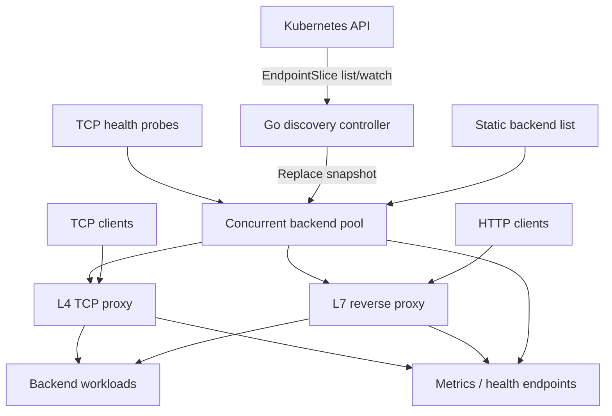

# CloudMesh

A small Kubernetes-aware networking platform written in Go. CloudMesh separates endpoint discovery and backend state reconciliation from the forwarding path. The same forwarding engine runs against static local backends or dynamically discovered Kubernetes endpoints. A separate Linux lab explores network virtualization, address allocation and packet filtering without changing the host's firewall.

## What works

| Feature | Status |
| --- | --- |
| Concurrent L4 TCP forwarding and L7 HTTP reverse proxy | Tested locally |
| Round-robin, least-connections, rendezvous hashing | Tested locally |
| Backend health checks and failover for new traffic | Tested locally |
| IPv4/IPv6 backend addressing and bounded IPAM | Tested locally (IPv6 loopback test skips if unavailable) |
| Kubernetes EndpointSlice list/watch, reconciliation, TLS and RBAC manifests | Mock API tested; actual kind deployment not yet verified |
| Prometheus-format metrics and health/readiness endpoints | Tested locally |
| Linux namespaces, veth, VXLAN, iptables/ip6tables, IPv4 DNAT | Go command plan tested; privileged execution not yet verified |
| Docker image, dual-stack kind config, CI workflow | Supplied; Docker/kind/hosted CI not executed here |
| BGP route management, actual GCP hybrid cloud, CNI, CRDs and eBPF | Future extensions, not implemented |

## Architecture



The controller and proxy share an in-process snapshot in this prototype. The Linux lab is a separate program; it is not a Kubernetes CNI. See [design notes](docs/design.md) for engineering trade-offs.

## Quick start (no Docker, Kubernetes or cloud account needed)

Requirements: Go 1.23 or newer, Bash, curl, make. Works on macOS or Linux; the Linux-specific namespace experiment requires a Linux VM.

```sh
make test
make demo
```

The demo builds three binaries, starts two local echo services and CloudMesh, sends HTTP and TCP requests, stops one backend, checks that new traffic reaches the remaining backend, and prints metrics. It uses loopback ports 18080–18082, 19000 and 19090, so ensure these are free. Processes are cleaned up on exit.

Manual run, each command in a separate terminal:

```sh
make build
./bin/echo -listen 127.0.0.1:18081 -id alpha
./bin/echo -listen 127.0.0.1:18082 -id beta
./bin/cloudmesh -http 127.0.0.1:18080 -tcp 127.0.0.1:19000 \
  -admin 127.0.0.1:19090 -backends 127.0.0.1:18081,127.0.0.1:18082 \
  -algorithm round-robin
```

```sh
curl http://127.0.0.1:18080/api  # HTTP proxy
curl http://127.0.0.1:19000/api  # HTTP bytes over raw TCP forwarding
curl http://127.0.0.1:19090/readyz
curl http://127.0.0.1:19090/metrics
```

Select `-algorithm least-connections` or `-algorithm hash` to compare scheduling behavior. In hash mode use `curl -H 'X-CloudMesh-Key: session-123' ...` for a repeatable HTTP key. DNS hostnames are accepted in static backend addresses and resolved by Go's dialer; in Kubernetes mode the controller consumes IP endpoints directly. Kubernetes provides CoreDNS, but CloudMesh is not a DNS server.

## Kubernetes demo (local kind cluster)

Install Docker, kind and kubectl. Run in a Linux VM with sufficient memory and IPv6 support for the dual-stack cluster; the default kind networking plugin is used, not a custom CNI. If dual-stack is unavailable, change `ipFamily: dual` to `ipFamily: ipv4` in `deploy/kubernetes/kind.yaml` and do not claim dual-stack cluster validation.

```sh
bash scripts/kube-demo.sh
kubectl --context kind-cloudmesh -n cloudmesh port-forward deployment/cloudmesh 18080:8080 19000:9000 19090:9090
```

In another terminal:

```sh
for i in $(seq 1 8); do curl -fsS http://127.0.0.1:18080/api; done
kubectl --context kind-cloudmesh -n cloudmesh get endpointslices -l kubernetes.io/service-name=echo -o wide
kubectl --context kind-cloudmesh -n cloudmesh scale deployment/echo --replicas=1
kubectl --context kind-cloudmesh -n cloudmesh rollout status deployment/echo
curl -fsS http://127.0.0.1:19090/metrics
kubectl --context kind-cloudmesh -n cloudmesh scale deployment/echo --replicas=3
```

Wait for readiness and EndpointSlice changes before comparing backend identity. For actual in-cluster DNS, run `kubectl --context kind-cloudmesh -n cloudmesh run dns-check --rm -it --restart=Never --image=busybox:1.36 -- nslookup echo.cloudmesh.svc.cluster.local` (image download required). Delete the lab with `kind delete cluster --name cloudmesh` after stopping port-forward.

## Linux networking lab

See [Linux data plane lab](docs/linux-lab.md) for a separate local experiment that programs veth interfaces, VXLAN, dual-stack IPAM, scoped iptables filtering and DNAT from Go. The lab can connect the CloudMesh proxy to overlay backends. It simulates two network sites, not real cloud infrastructure. Start with `bin/netlab -action plan` before privileged execution. [BGP and GCP extension notes](docs/bgp-extension.md) describe remaining work.

## Benchmarking

With the manual demo running, execute (Python 3 required):

```sh
python3 scripts/benchmark.py http://127.0.0.1:18081/api --requests 1000 --workers 16
python3 scripts/benchmark.py http://127.0.0.1:18080/api --requests 1000 --workers 16
```

Report successful requests/sec, failures, and successful-request p50/p95/p99 latency. Repeat several times, record machine and Go version, and keep worker count and workload fixed. Direct backend vs proxy is a simple overhead comparison, not a production load-balancer performance comparison. The generator itself can become a bottleneck. No fixed performance improvement is claimed.

## Layout

```
cmd/cloudmesh/       CLI and server lifecycle
cmd/echo/            demo workload
cmd/netlab/          isolated Linux lab CLI
internal/discovery/  Kubernetes list/watch client
internal/pool/       backend reconciliation and scheduling
internal/proxy/      TCP/HTTP forwarding, health and metrics
internal/ipam/       bounded IPv4/IPv6 allocator
internal/netlab/     generated Linux networking commands
scripts/            demos and benchmark
deploy/kubernetes/   local kind and workload manifests
docs/                design, limitations, verification and lab notes
.github/workflows/   Go race tests, vet and smoke demo
```

## Verification and limitations

See [verification results](docs/verification.md) for actual checks performed. This is an educational prototype for trusted local networks, not a production service. It lacks authentication on the forwarding plane, TLS termination, persisted IPAM, global connection limits, full HA, production network policy semantics, and BGP/GCP integration. The Linux and Kubernetes deployments require independent verification on your machine. The repository was initially generated with AI assistance; review the code, run the tests and document your own design changes and measurements before representing the project as your work.

## References

- [Kubernetes EndpointSlices](https://kubernetes.io/docs/concepts/services-networking/endpoint-slices/)
- [Kubernetes EndpointSlice API](https://kubernetes.io/docs/reference/kubernetes-api/discovery/endpoint-slice-v1/)
- [kind cluster configuration](https://kind.sigs.k8s.io/docs/user/configuration/)
- [Go HTTP reverse proxy](https://pkg.go.dev/net/http/httputil#ReverseProxy)
