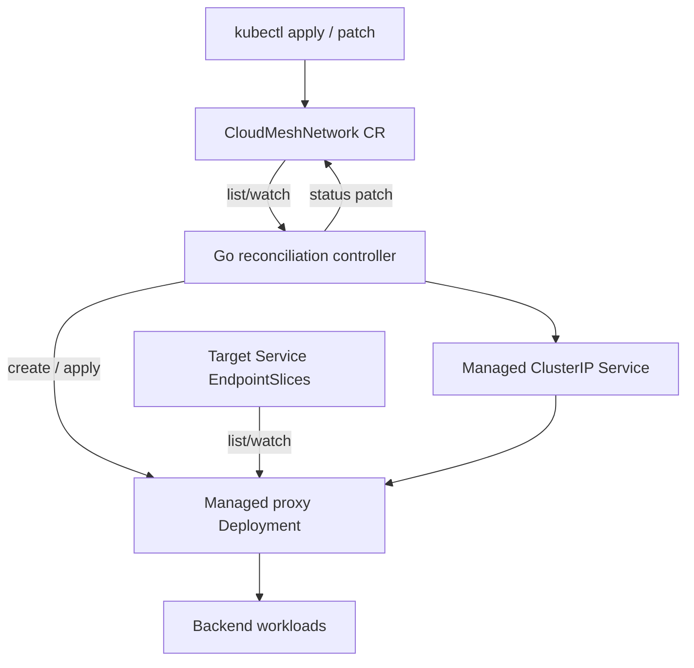

# Custom CloudMeshNetwork controller

## Goal

Expose the existing Go proxy as a declarative Kubernetes API. A namespaced
`CloudMeshNetwork` object describes a target Service/port, scheduling algorithm,
proxy replicas and TCP probe interval. A separate Go controller creates or
updates an owned proxy Deployment and internal ClusterIP Service (`cm-<name>`).
The proxy itself continues to discover ready EndpointSlices through the original
`cloudmesh` ServiceAccount and uses the existing forwarding engine.



## Run

Install Go 1.23+, Docker with a running daemon, kind, kubectl, Bash, curl and
make. On macOS use Docker Desktop or a compatible VM runtime. Use a disposable
cluster, not a real environment. The original kind config is dual-stack; if
unsupported, use an IPv4-only kind config and document that limitation.

From the existing repository root, merge the additive upgrade files, then:

```sh
gofmt -w cmd/controller internal/controller
make test
go test -cover ./internal/controller
make demo
bash scripts/controller-demo.sh
```

The script builds two local images, creates a named kind cluster if necessary,
installs the original CloudMesh manifests, installs the CRD and controller,
and applies the example CR. All kubectl calls use `kind-cloudmesh-controller`.
The example waits for status Ready. Rerunning the script refreshes the
controller pod, but if you changed the proxy image under the same tag you
may also need to restart the managed proxy Deployment. For repeatable clean
runs delete the disposable cluster first.

```sh
kubectl --context kind-cloudmesh-controller -n cloudmesh get cmn
kubectl --context kind-cloudmesh-controller -n cloudmesh get deploy,svc
kubectl --context kind-cloudmesh-controller -n cloudmesh get cmn application-network -o yaml
kubectl --context kind-cloudmesh-controller -n cloudmesh logs deploy/cloudmesh-controller
```

In a separate terminal:

```sh
kubectl --context kind-cloudmesh-controller -n cloudmesh port-forward svc/cm-application-network 18080:8080 19000:9000
```

```sh
curl -fsS http://127.0.0.1:18080/api
curl -fsS http://127.0.0.1:19000/api
```

## Validate updates, recovery and cleanup

Run the following from Bash or zsh, using the explicit local context:

```sh
k() { kubectl --context kind-cloudmesh-controller -n cloudmesh "$@"; }
k patch cmn application-network --type=merge -p '{"spec":{"loadBalancing":{"algorithm":"least-connections"},"replicas":2}}'
k get cmn application-network -o yaml
k get deployment cm-application-network -o jsonpath='{.spec.template.spec.containers[0].args}'; echo
```

Wait until the CR's `status.observedGeneration` equals `metadata.generation`,
the Deployment has the new args, and `status.phase` is `Ready`. The finite
watch refreshes rollout status roughly every 15 seconds (plus request and
rollout time). `kubectl wait` for Ready alone can briefly see the previous
status immediately after a patch. Inspect the actual status and rollout:

```sh
k rollout status deployment/cm-application-network --timeout=180s
k get cmn application-network -o jsonpath='{.metadata.generation} {.status.observedGeneration} {.status.phase} {.status.availableReplicas}'; echo
```

Re-establish port forwarding if the selected Pod was replaced during rollout.
Scale the managed Deployment to one replica manually and verify the controller
restores the desired two replicas on a periodic relist:

```sh
k scale deployment/cm-application-network --replicas=1
k get deployment cm-application-network -w
```

Stop the watch with Ctrl+C after verifying `spec.replicas` returns to 2.
Delete the managed Service to verify it is recreated. Its ClusterIP can change:

```sh
k delete svc cm-application-network
k get svc cm-application-network
```

Repeat the GET after the next controller resync if the Service is not found.
Test admission rejection (the command should fail):

```sh
k patch cmn application-network --type=merge -p '{"spec":{"loadBalancing":{"algorithm":"invalid"}}}'
```

Test garbage collection after removing the CR (allow time for asynchronous GC):

```sh
k delete cmn application-network
k wait --for=delete deployment/cm-application-network --timeout=120s
k wait --for=delete svc/cm-application-network --timeout=120s
kind delete cluster --name cloudmesh-controller
```

## Design decisions and limits

- Keep the data plane intact and separate the new controller into its own binary.
- Reuse the original in-cluster REST/TLS configuration and standard library; no
  new Go dependencies. This is a small educational alternative to controller-runtime.
- A single worker reconciles a snapshot and then watches generation changes. A
  15-second finite watch causes periodic full relists to refresh status and repair
  missing children. A failed watch triggers bounded backoff and relisting. Status-only
  events are ignored to prevent feedback loops. This is not a production informer,
  workqueue, leader-election system or high-availability controller.
- Scope permissions to the `cloudmesh` namespace. The controller owns only child
  objects with a matching CR UID; it refuses to adopt collisions. Server-side apply
  with a resourceVersion precondition updates declared fields on owned objects.
  Owner references let Kubernetes garbage collection remove children on CR deletion.
- `contains` compares the declared fields while tolerating server defaults. This is
  not exhaustive drift detection (e.g. externally injected map keys). Do not share
  ownership of managed fields with other controllers. A missing target Service is
  reported as Degraded; an existing proxy is retained with its last configuration.
- `Ready` means the desired number of proxy replicas is available for the observed
  deployment generation. It does not certify every route or backend independently.
- Replicas are independent proxy instances; counters and scheduling state are local,
  not globally coordinated. A spec change rolls out a new Pod template if args change.
- This feature configures load balancing, not Linux kernel networking, CNI, BGP or
  network policy. The original discovery retry and proxy health implementations
  remain unchanged. The controller does not introduce HTTP health probes or connection
  limits; the probe interval controls existing TCP probes.
- Only local trusted workloads are intended. The controller has namespace-scoped
  workload creation permissions and is not hardened for untrusted multi-tenant use.

## Verification before publication

In a merged copy of the original source, Go 1.23.2 on Linux:

- `go test -race ./...` passed (six internal packages).
- `go vet ./...` passed.
- `go test -cover ./internal/controller`: 80.4% statement coverage.
- `go build ./cmd/controller` passed.
- Existing `make demo` passed HTTP distribution, TCP forwarding and backend failover.
- `bash -n scripts/controller-demo.sh` passed.

Docker, kind and kubectl were not available in the test environment, so live
Kubernetes admission, server-side apply, scheduling, status rollout and owner-reference
cleanup remain to be verified by running the instructions above. The mock API tests
cannot establish those behaviors. Record your actual local results and any fixes.

## Your own engineering follow-ups

Try adding a status condition with a reason field, testing API conflicts (409),
checking behavior on a Service with an invalid port, adding child-resource watches,
or improving the retry policy. Document why you chose the change, show a failing test
before the fix, and rerun verification. Keep AI-assistance attribution accurate.
