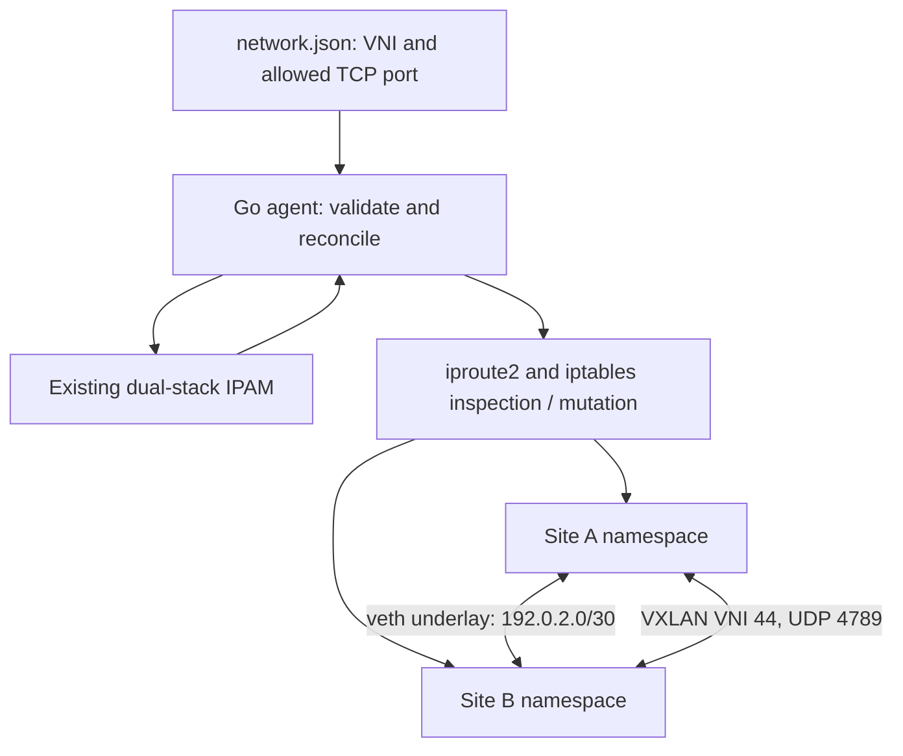

# CloudMesh Linux network agent

The agent extends the existing one-shot `netlab` experiment with a desired-state reconciliation loop. The goal is to learn how infrastructure software inspects and configures a Linux network, detects drift, and restores the expected state. It reuses CloudMesh's existing dual-stack IPAM allocator. It is a standalone lab component; the Kubernetes `CloudMeshNetwork` controller does not yet configure it.

The initial agent implementation was prepared with AI assistance. The unit-test evidence included here is from the development sandbox, not the laptop deployment. The live demo below is designed to produce an independent validation record.

## Architecture



Both sites live in a disposable privileged Linux container on Docker Desktop's Linux VM. They are network namespaces, not separate physical hosts, cloud deployments or Kubernetes pods. The underlay carries the encapsulated Ethernet frames; IPv4 and IPv6 are carried in the overlay. This demonstrates simulated multi-site connectivity, not an actual cloud connection.

| Resource | Site A | Site B |
|---|---|---|
| Namespace | `cma-site-a` | `cma-site-b` |
| Underlay veth | `cma-under-a` | `cma-under-b` |
| Underlay IPv4 | `192.0.2.1/30` | `192.0.2.2/30` |
| VXLAN device | `cma-vxlan` | `cma-vxlan` |
| Overlay IPv4 | `10.44.0.1/24` | `10.44.0.2/24` |
| Overlay IPv6 | `fd44:44::1/64` | `fd44:44::2/64` |
| IPv4 virtual service | `10.44.0.100:8081` | DNAT destination `10.44.0.2:8081` |

The filter chain allows established/related TCP connections first, accepts new traffic to the configured port, and drops other incoming TCP traffic on the VXLAN interface. ICMP and other protocols are not restricted by this demonstration policy. The stateful rule is essential: replies to a client ephemeral port must not be blocked. IPv4 OUTPUT DNAT translates the virtual service address to the remote backend; this is a fixed translation for a single backend, not the existing Go load balancer's scheduling engine.

## Reconciliation design

1. Read the JSON configuration and reject invalid VNI/port values or unknown fields.
2. Allocate the two sites' IPv4/IPv6 addresses using deterministic IPAM allocation.
3. Inspect existing namespaces and virtual interfaces. Create missing namespaces and the veth pair.
4. Inspect link state, addresses and VXLAN attributes. Restore missing interfaces or addresses and replace VXLAN devices if their VNI/underlay parameters differ.
5. Inspect firewall rule order and managed chains. Atomically replace only the agent-owned chain with `iptables-restore --noflush` when necessary, then ensure the parent chain has exactly one matching hook at its first position. Apply IPv4/IPv6 filter rules and IPv4 DNAT.
6. Log the number of successful mutation operations. Wait for the configured interval and repeat.

A healthy second pass should have `changes=0`. A partial failure is logged and retried rather than pretending all changes were applied. The agent does not delete arbitrary additional addresses or other people's rules; its scope is the fixed lab resources. If a named interface exists with the wrong type, it refuses to replace it. It deliberately uses the netlink-backed `ip` utility and `iptables` via Go's `os/exec`, with explicit arguments and timeouts, rather than implementing raw netlink messages or using shell interpolation.

## Files

| File | Purpose |
|---|---|
| `cmd/agent/main.go` | Config loading, periodic loop, signal handling and one-shot CLI |
| `internal/agent/agent.go` | Spec validation, desired state, IPAM and reconciliation order |
| `internal/agent/linux.go` | Linux state inspection and conditional mutations |
| `internal/agent/agent_test.go` | In-memory kernel and scripted command tests |
| `Dockerfile.agent` | Go build and isolated Linux runtime with networking tools |
| `examples/linux-network.json` | Initial desired state |
| `scripts/agent-demo.sh` | End-to-end assertions using a disposable container |
| `docs/results/agent-unit-tests.txt` | Actual sandbox unit/race test transcript |

## Run locally on a Mac

Start Docker Desktop and ensure it is healthy. Because the earlier CloudMesh run encountered a Docker storage failure, check host storage before building another image. No kind cluster is required for this upgrade.

```bash
# Inspect available host storage and verify Docker can start containers.
df -h /System/Volumes/Data
docker info
docker run --rm hello-world

# From the project root, test the Go logic without privileges.
go test -race -v ./internal/agent/
go test -cover ./internal/agent/
make test
make demo

# Validate actual Linux packet forwarding and state repair.
bash scripts/agent-demo.sh
```

The demo builds `cloudmesh-agent:local`, starts one disposable container with `--privileged --network none` and no host bind mounts, executes the agent and networking tests, and removes only that container on exit. It does not touch any existing kind cluster. Privileged mode grants broad capabilities within the Docker Linux VM; network isolation is not a security boundary against privileged code. Run this only with the trusted local source/image in a disposable development environment, never on a production host, and never add host networking, the Docker socket, or host filesystem mounts. The executable requires Linux and the explicit lab environment flag. Do not set that flag on a normal Linux host.

## What the live demo verifies

| Experiment | Assertion |
|---|---|
| Initial reconciliation | Configured resources are created |
| Second reconciliation | Agent reports zero mutations |
| IPv4 and IPv6 overlay | Ping and successful HTTP response through VXLAN |
| IPv4 DNAT | Virtual service returns remote echo backend response |
| Firewall | Port 8082 is blocked over IPv4 and IPv6 even though a backend is listening |
| Drift recovery | Deleted VXLAN device is recreated and both address families work again |
| Dynamic policy | Update allowed port from 8081 to 8082 without restarting the agent; fresh connections to the former port are blocked |

Expected final line (not a recorded live result):

```text
PASS: Linux agent reconciliation, VXLAN, IPv4/IPv6, firewall, DNAT and drift recovery
```

The script exits on a failed assertion. It prints available diagnostic state before cleanup when something goes wrong. For a permanent record on macOS zsh:

```bash
set -o pipefail
bash scripts/agent-demo.sh 2>&1 | tee /tmp/cloudmesh-agent-demo.log
```

Review the log for sensitive information and copy it into `docs/results/` only after the demo actually succeeds. Do not report the expected PASS line as a measured result.

## Inspect the network manually (optional)

The automated demo removes its container when done. For exploration, create a separate disposable container after building the image:

```bash
docker build -f Dockerfile.agent -t cloudmesh-agent:local .
docker run --rm -d --privileged --network none \
  --name cloudmesh-agent-manual --entrypoint /bin/sleep \
  cloudmesh-agent:local infinity

docker exec cloudmesh-agent-manual /agent -once
docker exec cloudmesh-agent-manual /agent -once
```

The first pass should configure the network. The second should report `changes=0`.

```bash
# List namespaces and inspect the overlay device configuration.
docker exec cloudmesh-agent-manual ip netns list
docker exec cloudmesh-agent-manual ip -n cma-site-a -d link show dev cma-vxlan

# Inspect IPv4/IPv6 addresses and connected routes.
docker exec cloudmesh-agent-manual ip -n cma-site-a addr show
docker exec cloudmesh-agent-manual ip -n cma-site-a route show
docker exec cloudmesh-agent-manual ip -n cma-site-a -6 route show

# Inspect VXLAN forwarding database and neighbor entries.
docker exec cloudmesh-agent-manual ip netns exec cma-site-a bridge fdb show dev cma-vxlan
docker exec cloudmesh-agent-manual ip -n cma-site-a neigh show

# Inspect policy and packet counters, and the IPv4 virtual service mapping.
docker exec cloudmesh-agent-manual ip netns exec cma-site-b iptables -nvL CMA-FILTER
docker exec cloudmesh-agent-manual ip netns exec cma-site-b ip6tables -nvL CMA-FILTER
docker exec cloudmesh-agent-manual ip netns exec cma-site-a iptables -t nat -S CMA-DNAT

# End the optional lab. No other container is removed.
docker rm -f cloudmesh-agent-manual
```

## Verification status

The agent's unit/race tests and the original application regression demo passed in the development environment. Agent statement coverage was 82.0%. Go vet passed. Shell syntax was checked and the agent was cross-compiled for Apple Silicon macOS (it intentionally refuses to perform Linux operations on macOS). The execution environment did not provide Docker or sufficient Linux namespace privileges, so the Docker image build and live network tests have **not** been executed there. The `agent-demo.sh` assertions remain to be run on the laptop. Linux kernel feature availability (VXLAN, network namespaces, IPv6, conntrack, NAT and iptables) is an integration requirement.

## Limitations and next steps

- One agent, one lab topology, fixed prefixes and a single allowed TCP port. No general-purpose network policy or CNI implementation.
- The agent does not yet consume Kubernetes custom resources; the existing controller and load balancer remain separate components.
- No persistent IPAM or actual BGP, cloud VPC, VM-to-pod or cross-host networking.
- Kernel operations use iproute2's netlink interface via a subprocess, not a direct Go netlink library.
- Replacing a VXLAN interface can disrupt active flows. The reconciliation loop is single-worker, with bounded command execution, not an HA system or a production-grade transaction engine.
- Rules are applied inside lab namespaces only. Additional unmanaged addresses and nonmatching rules are outside the reconciliation contract.

Useful references: [ip-link(8)](https://man7.org/linux/man-pages/man8/ip-link.8.html), [ip-netns(8)](https://man7.org/linux/man-pages/man8/ip-netns.8.html), [iptables-restore(8)](https://man7.org/linux/man-pages/man8/iptables-restore.8.html).
