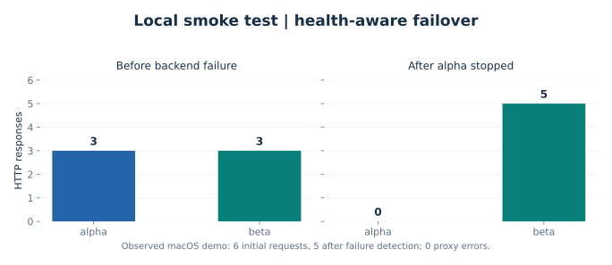
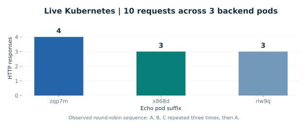
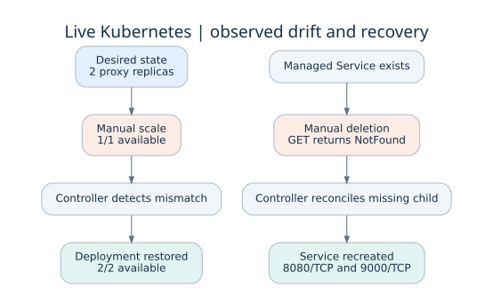
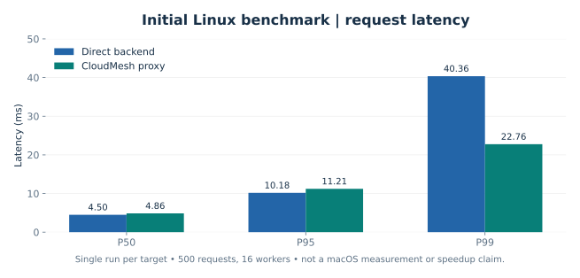
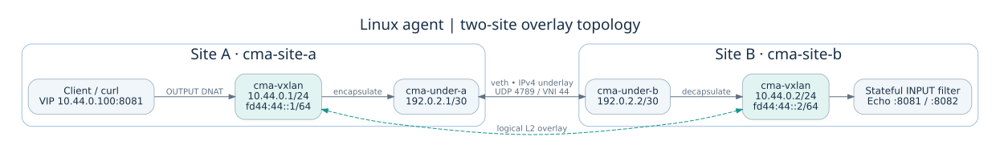
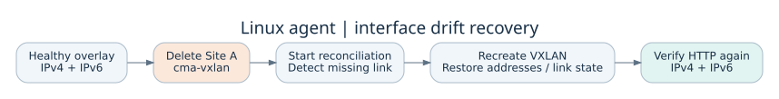

# CloudMesh — Verification and Results

This document records the tests I ran on my Mac on November 26, 2026, along with a clearly identified historical Linux benchmark. It is a reproducibility record, not a production performance or availability claim. The initial implementation, controller extension and Linux agent were developed with AI assistance; the macOS deployment, debugging and test runs below are my recorded validation work.

[Back to project README](../README.md) · [Controller design](custom-controller.md) · [Original verification notes](verification.md)

## Environment and scope

| Item | Observed environment |
| --- | --- |
| Host | Apple Silicon macOS (arm64) |
| Containers | Docker Desktop; local application and controller images |
| Kubernetes | kind, two nodes, v1.37.0 |
| Networking | Cluster configured for dual stack; demonstrated HTTP/TCP requests used IPv4 localhost |
| Source revision | Controller feature commit `282f244` (pushed after live validation) |
| Historical benchmark | Initial Linux development environment; separate from macOS results |

## 1. Result summary

| Verification | Observed result |
| --- | --- |
| Go race-test invocation | Six internal packages passed |
| Static analysis | `go vet ./...` completed without errors |
| Controller statement coverage | 80.4% |
| Local HTTP distribution | 3 requests per backend before failure |
| Local failover | 5/5 subsequent HTTP requests reached surviving backend |
| Local proxy errors | 0 in the demonstration |
| Kubernetes nodes | 2/2 Ready after cluster recreation |
| Echo backends | 3/3 available |
| Live round robin | 10 responses distributed 4/3/3 |
| Configuration update | Generation 2 observed; Ready; 2 proxy replicas |
| Drift recovery | Replica count restored from 1 to 2 |
| Service recovery | Deleted Service recreated |
| Invalid configuration | Rejected by CRD schema |
| Owner cleanup | Deployment and Service deletion waits completed |
| Linux agent | Live demo passed (author-confirmed; transcript pending) |
| Agent statement coverage | 82.0% in initial development environment (pre-fix) |

## 2. Automated tests and coverage

### Run automated tests

```bash
gofmt -w cmd/controller/ internal/controller/
go test -v ./internal/controller/
go test -race ./internal/controller/
make test
```

`gofmt` applies standard Go formatting. `go test -v` shows each test name, `-race` detects data races encountered during test execution, and `go vet` performs static analysis for suspicious Go constructs. The `cmd` packages are executable entry points and have no separate test files; the internal packages contain the tested logic.

The controller tests include:

| Test | Behavior covered |
| --- | --- |
| `TestValidate` | Valid configuration and rejection of invalid algorithm, replica count, interval, self-reference and numeric port. |
| `TestDesired` | Generation of desired child resources. |
| `TestReconcileLifecycle` | Child creation, updates, idempotency and recovery of missing resources. |
| `TestReconcileRejectsUnowned` | Protection against adopting an existing resource with the wrong owner. |
| `TestMissingTarget` | Handling a missing target Service. |
| `TestDeletionSkipsWrites` | Avoiding new writes for a resource being deleted. |
| `TestWatchGenerationAndExpiry` | Generation-aware watch handling and expired watch recovery. |

All seven top-level controller tests (including validation subtests) passed in the macOS run. All six internal packages passed the full race-test invocation, and `go vet` completed without errors. Some package results were cached, which is normal for Go's test runner. To force fresh executions, use `go test -race -count=1 ./...`.

### Generate a coverage report

```bash
go test -cover ./internal/controller/
go test -coverprofile=/tmp/cloudmesh-controller-coverage.out ./internal/controller/
go tool cover -html=/tmp/cloudmesh-controller-coverage.out \
  -o /tmp/cloudmesh-controller-coverage.html
open /tmp/cloudmesh-controller-coverage.html
```

The `open` command is macOS-specific; on Linux, open the HTML file with a browser. Coverage files are written to `/tmp`, not committed to Git.

Observed result:

```text
ok  cloudmesh/internal/controller  0.422s  coverage: 80.4% of statements
```

The separate coverage-profile run also reported 80.4%. Statement coverage applies only to the controller package and is not a measure of production reliability or whole-repository coverage.

## 3. Local smoke test (macOS)

```bash
make demo
```

This compiles the executables, starts two local echo processes and CloudMesh, sends traffic, then stops one backend to exercise health-aware scheduling.



The six initial HTTP requests alternated between `alpha` and `beta`. A separate TCP-forwarded request reached `alpha`. After stopping `alpha`, all five subsequent HTTP requests reached `beta`.

```text
HTTP distribution: alpha, beta, alpha, beta, alpha, beta
Raw TCP forwarding: alpha
After backend alpha stops: beta, beta, beta, beta, beta
PASS: distribution, TCP forwarding, backend failover
```

Actual metrics from the macOS regression run:

| Metric | Value |
| --- | ---: |
| `cloudmesh_http_requests_total` | 11 |
| `cloudmesh_tcp_connections_total` | 1 |
| `cloudmesh_proxy_errors_total` | 0 |
| `cloudmesh_active_tcp` (at end of demo) | 0 |
| `cloudmesh_ready_backends` (after failure) | 1 |
| `cloudmesh_reconciliations_total` | 1 |
| `cloudmesh_discovery_errors_total` | 0 |

This demonstrates failover for new requests after the failed backend has been detected. It does not imply that an already established TCP session can be migrated or that no request could fail during the detection interval.

## 4. Live Kubernetes deployment

From the repository root, with Docker running and `kind` and `kubectl` installed:

```bash
bash scripts/controller-demo.sh
kubectl --context kind-cloudmesh-controller get nodes
kubectl --context kind-cloudmesh-controller get pods -n kube-system
k() {
  kubectl --context kind-cloudmesh-controller -n cloudmesh "$@"
}
k get cmn
k get deployments,services
```

The script creates or reuses the named local cluster, builds and loads the two images, applies the base workloads, CRD and controller, and waits for the example custom resource. The context and namespace are explicit to avoid changing other clusters.

After recovering the original damaged kind cluster, both nodes were `Ready` and both CoreDNS pods were running. The deployment script completed successfully and returned the following workload counts:

```text
NAME                                 READY   UP-TO-DATE   AVAILABLE
cloudmesh                            1/1     1            1
cloudmesh-controller                 1/1     1            1
cm-application-network               1/1     1            1
echo                                 3/3     3            3
```

The controller log confirmed it was watching the `cloudmesh` namespace. The resource reported:

```yaml
status:
  availableReplicas: 1
  message: Desired proxy replicas available
  observedGeneration: 1
  phase: Ready
  proxyService: cm-application-network
```

## 5. Live controller experiments

The following tests were performed against the actual local Kubernetes API, not the mock API used in unit tests. Outputs are abbreviated from the successful run; pod names, Service IPs and ages will differ on other machines.

### Test 1 — HTTP and TCP forwarding

In a separate terminal, expose the managed Service to the laptop:

```bash
kubectl --context kind-cloudmesh-controller -n cloudmesh \
  port-forward svc/cm-application-network 18080:8080 19000:9000
```

Keep this process running. It maps local port 18080 to the proxy's HTTP listener and 19000 to its TCP listener. Port-forward selects a pod behind the Service; this test exercises the managed proxy and its backend forwarding, not the complete ClusterIP routing path.

In another terminal:

```bash
curl -fsS http://127.0.0.1:18080/api
curl -fsS http://127.0.0.1:19000/api
```

Observed responses:

```json
{"backend":"echo-7f5c9c8f58-x868d","method":"GET","path":"/api"}
{"backend":"echo-7f5c9c8f58-rlw9q","method":"GET","path":"/api"}
```

Both calls returned the identity of an actual echo pod, confirming HTTP reverse proxying and TCP forwarding through the controller-managed deployment.

### Test 2 — Round-robin distribution across three Kubernetes backends

```bash
for i in $(seq 1 10); do
  curl -fsS http://127.0.0.1:18080/api
  echo
done
```

The observed sequence was `zqp7m, x868d, rlw9q` repeated three times, followed by `zqp7m`.

| Backend (pod suffix) | Requests received |
| --- | ---: |
| `zqp7m` | 4 |
| `x868d` | 3 |
| `rlw9q` | 3 |
| **Total** | **10** |

All ten calls returned valid backend responses. This is consistent with round-robin scheduling over three available endpoints. It confirms that the managed proxy could discover and forward to those Kubernetes pods.

For additional inspection, the following command lists the EndpointSlices for the target Service:

```bash
k get endpointslices -l kubernetes.io/service-name=echo -o wide
```

### Test 3 — Declarative configuration update

The initial configuration uses round robin and one proxy replica. I changed only the custom resource, without manually editing the managed Deployment:

```bash
k patch cmn application-network --type=merge \
  -p '{"spec":{"loadBalancing":{"algorithm":"least-connections"},"replicas":2}}'
```

Inspect the arguments applied by the controller:

```bash
k get deployment cm-application-network \
  -o jsonpath='{.spec.template.spec.containers[0].args}'
echo
```

Actual output:

```json
["-service=echo","-port-name=http","-algorithm=least-connections","-probe-interval=2s","-admin=:9090"]
```

Then wait for the Deployment rollout and inspect the custom resource's state:

```bash
k rollout status deployment/cm-application-network --timeout=180s
k get cmn application-network \
  -o jsonpath='{.metadata.generation} {.status.observedGeneration} {.status.phase} {.status.availableReplicas}'
echo
```

Observed:

```text
deployment "cm-application-network" successfully rolled out
2 2 Ready 2
```

The four values are the desired resource generation, observed generation, phase and available proxy replica count. Matching generations show that the controller processed the updated configuration. `Ready 2` confirms that two managed proxy replicas were available.

This test verifies configuration propagation and rollout. It does not measure least-connections distribution under concurrent load. Reopen port-forward if the previous selected pod was replaced during rollout.

### Test 4 — Automatic configuration drift recovery

Configuration drift occurs when an actual resource is changed outside the controller while the desired configuration remains unchanged. To simulate drift, I manually reduced the managed Deployment to one replica:

```bash
k scale deployment/cm-application-network --replicas=1
k get deployment cm-application-network -w
```

Observed rollout progression (intermediate repeated lines omitted):

```text
NAME                     READY   UP-TO-DATE   AVAILABLE
cm-application-network   1/1     1            1
cm-application-network   1/2     1            1
cm-application-network   1/2     2            1
cm-application-network   2/2     2            2
```

The custom resource still requested two replicas. The controller detected the mismatch and restored the Deployment to two available replicas without another manual scaling command. Stop the watch using Ctrl+C.

### Test 5 — Recovery of a deleted managed Service

```bash
k delete service cm-application-network
k get service cm-application-network
```

The immediate GET returned `NotFound`. Repeating the GET after reconciliation showed that the Service had been recreated:

```text
NAME                     TYPE        CLUSTER-IP      PORT(S)            AGE
cm-application-network   ClusterIP   10.96.159.253   8080/TCP,9000/TCP   15s
```

The original Service had a different ClusterIP. This is expected when a deleted Service is recreated. The displayed age is the age of the new Service at inspection time, not a measured recovery duration.

This verifies that the controller can recreate a missing owned resource rather than merely configuring resources at startup.

### Test 6 — Reject invalid network configuration

```bash
k patch cmn application-network --type=merge \
  -p '{"spec":{"loadBalancing":{"algorithm":"invalid"}}}'
```

Expected and observed rejection:

```text
The CloudMeshNetwork "application-network" is invalid:
spec.loadBalancing.algorithm: Unsupported value: "invalid":
supported values: "round-robin", "least-connections", "hash"
```

The Kubernetes API rejects the unsupported value through the CRD schema. The failed command is intentional; the valid resource configuration remains unchanged.

### Test 7 — Resource deletion and automatic cleanup

Stop any port-forward sessions, then delete the custom resource:

```bash
k delete cmn application-network
k wait --for=delete deployment/cm-application-network --timeout=120s
k wait --for=delete service/cm-application-network --timeout=120s
```

All three commands completed without an error. Kubernetes garbage collection removes dependent resources through the owner references set by the controller. The base echo and original CloudMesh resources are not owned by this custom resource.

For a repeat run, apply the example again:

```bash
k apply -f examples/application-network.yaml
k wait --for=jsonpath='{.status.phase}'=Ready cmn/application-network --timeout=180s
```





## 6. Historical performance benchmark (Linux)



The repository contains a Python HTTP benchmark that reports successful throughput, failed requests and successful-request P50/P95/P99 latency. Start the manual local backend and proxy processes before running it.

```bash
python3 scripts/benchmark.py http://127.0.0.1:18081/api --requests 500 --workers 16
python3 scripts/benchmark.py http://127.0.0.1:18080/api --requests 500 --workers 16
```

Port 18081 accesses the backend directly. Port 18080 sends traffic through CloudMesh. The commands above are a reproduction example, not a new measurement from the successful macOS run.

Initial sample results from the original Linux development environment are stored in `docs/results/`:

| Metric | Direct backend | CloudMesh proxy |
| --- | ---: | ---: |
| Requests | 500 | 500 |
| Workers | 16 | 16 |
| Successful requests | 500 | 500 |
| Failed requests | 0 | 0 |
| Successful requests/sec | 2,566.55 | 2,589.06 |
| P50 latency | 4.503 ms | 4.860 ms |
| P95 latency | 10.183 ms | 11.211 ms |
| P99 latency | 40.358 ms | 22.763 ms |

These results are from one initial experiment, not my laptop and not evidence of a throughput or latency improvement. For a fair overhead comparison, configure the proxy with the same backend capacity as the direct baseline, hold workload parameters constant, perform warm-up, repeat trials and record system configuration. Repeated benchmarking, failover timing and concurrent scheduler comparisons remain future work.

Raw historical files: [direct.json](results/direct.json), [proxy.json](results/proxy.json), [local-demo.txt](results/local-demo.txt).

## 7. Environment troubleshooting

### Docker storage became read-only

During setup, Docker Desktop initially failed to build the image with:

```text
write .../containerd.../meta.db: read-only file system
```

Even `docker run --rm hello-world` failed, showing that the issue was in the Docker environment rather than the Go application. During restart attempts the Docker socket was temporarily unavailable. I checked available host storage and the Docker daemon:

```bash
df -h /System/Volumes/Data
docker system df
docker info
docker run --rm hello-world
```

Restarting Docker Desktop and retrying after the engine was available allowed both images to build successfully. The logs do not establish the exact underlying storage fault. If storage errors persist, check Docker's disk settings and free host space before considering a reset. A reset can delete existing containers, volumes and images; do not reset shared or important Docker data without a backup.

### Kubernetes worker became NotReady

After the Docker recovery, the first cluster's application pods stayed Pending with no IPs, and the echo rollout timed out. I traced the failure from the Deployment to the worker node and finally to kubelet logs:

```bash
kubectl --context kind-cloudmesh-controller get nodes
k get pods -o wide
k describe pods -l app=echo
k get events --sort-by=.lastTimestamp
kubectl --context kind-cloudmesh-controller describe node cloudmesh-controller-worker
kubectl --context kind-cloudmesh-controller get pods -n kube-system -o wide
docker ps -a --filter name=cloudmesh-controller
docker exec cloudmesh-controller-worker journalctl -u kubelet -n 60 --no-pager
docker exec cloudmesh-controller-worker df -h /
```

The worker was unreachable, its kubelet stopped posting node status, and both CoreDNS pods were in `CrashLoopBackOff`. The decisive kubelet message was:

```text
failed to load kubelet config file:
/var/lib/kubelet/config.yaml was empty
```

The kubelet had reached a restart counter above 300. The empty configuration prevented it from starting; the reason the file became empty was not confirmed.

Because this was a disposable local cluster, I recreated only that cluster:

```bash
kind delete cluster --name cloudmesh-controller
docker run --rm hello-world
kind create cluster --name cloudmesh-controller \
  --config deploy/kubernetes/kind.yaml --wait 180s
kubectl --context kind-cloudmesh-controller get nodes
kubectl --context kind-cloudmesh-controller get pods -n kube-system
bash scripts/controller-demo.sh
```

Both nodes returned to `Ready`, the system pods were running, and the controller deployment succeeded. This recovery did not require changing CloudMesh application code or deleting unrelated Docker workloads.

### Port-forward loses its connection

A port-forward session targets a specific pod. It may terminate with `lost connection to pod` during a rollout or resource deletion. If the custom resource still exists, verify its Deployment and restart port-forward against the managed Service:

```bash
k get pods
k rollout status deployment/cm-application-network --timeout=180s
kubectl --context kind-cloudmesh-controller -n cloudmesh \
  port-forward svc/cm-application-network 18080:8080 19000:9000
```

### Managed resources take time to recover

The current controller repairs supported child-resource drift on periodic relisting; it does not directly watch every child. A Service can temporarily return `NotFound` after deletion. Inspect the controller logs, check the custom resource's desired/observed generations and allow time for reconciliation.

## 8. Linux network agent validation

I completed the Linux agent tests after the DNAT troubleshooting step. The pass status below is my confirmation of the test run; the final successful terminal transcript is not yet included here. The assertions are taken from `scripts/agent-demo.sh`, not reconstructed terminal output. No packet counts, recovery times or post-fix coverage percentages are inferred.

| Experiment | Outcome reported after correction |
| --- | --- |
| Initial reconciliation | Passed — namespaces, links, addresses, filter chains and DNAT |
| Second reconciliation | Passed — zero-mutation assertion |
| Dual-stack VXLAN | Passed — IPv4 and IPv6 ping and HTTP |
| IPv4 virtual service | Passed — VIP reaches remote echo backend |
| Stateful firewall | Passed — live TCP port 8082 blocked over both families |
| Interface recovery | Passed — deleted VXLAN recreated and IPv4/IPv6 HTTP restored |
| Dynamic policy | Passed — port 8082 allowed and new connections to 8081 blocked, without agent restart |



```bash
# Test the Go logic without kernel privileges.
gofmt -w cmd/agent/ internal/agent/
go test -v ./internal/agent/
go test -race ./internal/agent/
go test -cover ./internal/agent/
make test
make demo

# Check Docker and run the isolated kernel integration tests.
docker info
docker run --rm hello-world
bash scripts/agent-demo.sh
```

`gofmt` normalizes the source formatting; the Go tests check configuration, reconciliation and simulated kernel operations. `make test` runs repository-wide race tests and `go vet`; `make demo` checks the original load balancer. The agent script builds the image, provisions the lab, executes assertions and removes only its own temporary container. It uses a privileged container with `--network none`, no host mounts or Docker socket. Privileged containers have broad Linux VM capabilities; use only trusted code in a disposable development environment.

Initial development-environment results: [unit test transcript](results/agent-unit-tests.txt) records all seven internal Go packages passing race tests and 82.0% agent statement coverage; [regression demo](results/agent-regression-demo.txt) records the original proxy smoke test. These are pre-fix results, not a new macOS coverage measurement.



### DNAT rule rejected during the first Linux agent run

The first privileged run reached 26 successful mutations, but the DNAT operation failed. Both namespaces and VXLAN devices were already present and up. The actual error was:

```text
reconcile partial_changes=26
reconcile error: virtual service DNAT: ... iptables-restore ...
Need TCP, UDP, SCTP or DCCP with port specification
```

The generated rule translated a destination including a TCP port, but did not specify the transport protocol in the DNAT rule itself. A TCP match on the parent chain is not sufficient for this rule to be accepted. The correction in `internal/agent/agent.go` is to include the explicit protocol; the regression-test expectations in `internal/agent/agent_test.go` should match it.

```diff
- -A CMA-DNAT -j DNAT --to-destination 10.44.0.2:8081
+ -A CMA-DNAT -p tcp -j DNAT --to-destination 10.44.0.2:8081
```

The successful rerun was confirmed after this troubleshooting step. The earlier mock tests did not exercise the real `iptables-restore` parser, which is why the error only became visible during integration testing. The initial partial mutation count is not the mutation count of the successful run.

### Preserve the successful transcript

If the log was not saved, rerun in the trusted disposable environment:

```bash
set -o pipefail
bash scripts/agent-demo.sh 2>&1 | tee /tmp/cloudmesh-agent-demo.log
```

After a successful exit, review the log and save it if appropriate:

```bash
cp /tmp/cloudmesh-agent-demo.log docs/results/linux-agent-macos.txt
```

## 9. What is not yet verified

CloudMesh is a learning-oriented infrastructure software prototype for trusted local environments. It is not a production Kubernetes CNI, a replacement for kube-proxy, or a deployed multi-cloud networking product.

The following are intentionally outside the current verified scope:

- Live dual-stack end-to-end Kubernetes traffic tests and in-cluster DNS validation. The cluster was configured for dual stack, but the demonstrated requests used IPv4 localhost. Static backend hostnames can be resolved by Go; CloudMesh is not a DNS server.
- Backend scaling/failure tests in Kubernetes under traffic; the local two-backend demo establishes basic failover, not cluster-wide failover behavior.
- Integration between the Linux agent and Kubernetes controller, actual multi-host overlays, BGP route management and actual GCP connectivity.
- Application-level HTTP health checks, connection limits, graceful backend draining and persisted IPAM allocations.
- High availability, leader election, parallel reconciliation workers, direct child-resource watches and a globally coordinated backend scheduler.
- Authentication/TLS termination on the forwarding plane, production multi-tenant isolation and large-scale performance evaluation.

The controller's `Ready` phase indicates desired proxy replica availability for the observed Deployment state; it is not a guarantee of every backend's reachability. The current retry and health mechanisms of the original proxy are distinct from the custom controller's retry logic.

## 10. Cleanup

```bash
kind delete cluster --name cloudmesh-controller
```

This removes the disposable CloudMesh cluster; it does not delete the source repository or other named kind clusters. I deleted the test cluster after the successful run.
